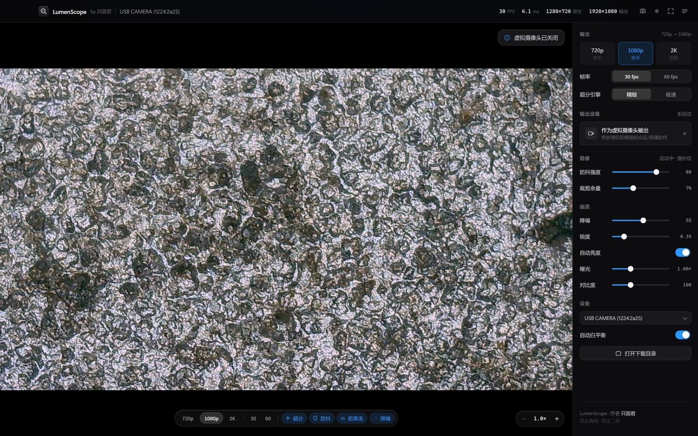
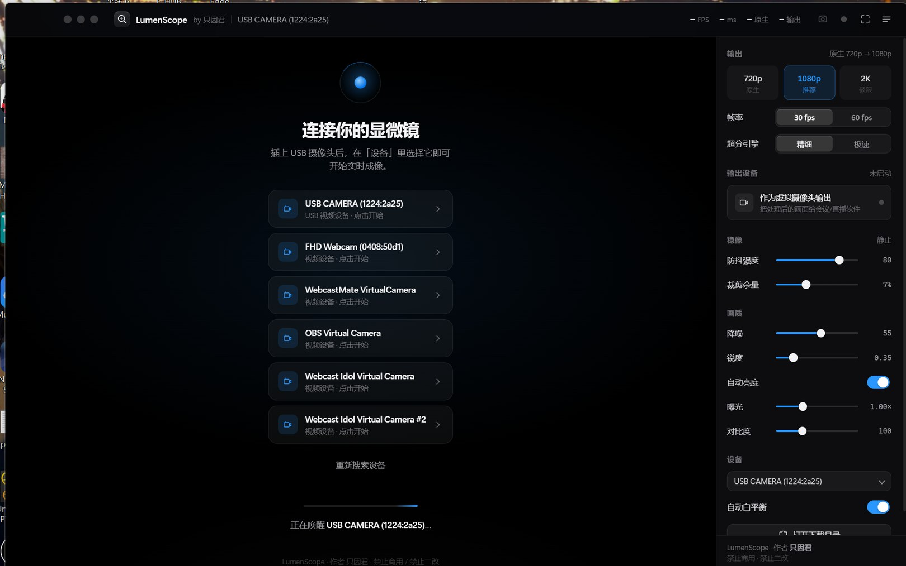
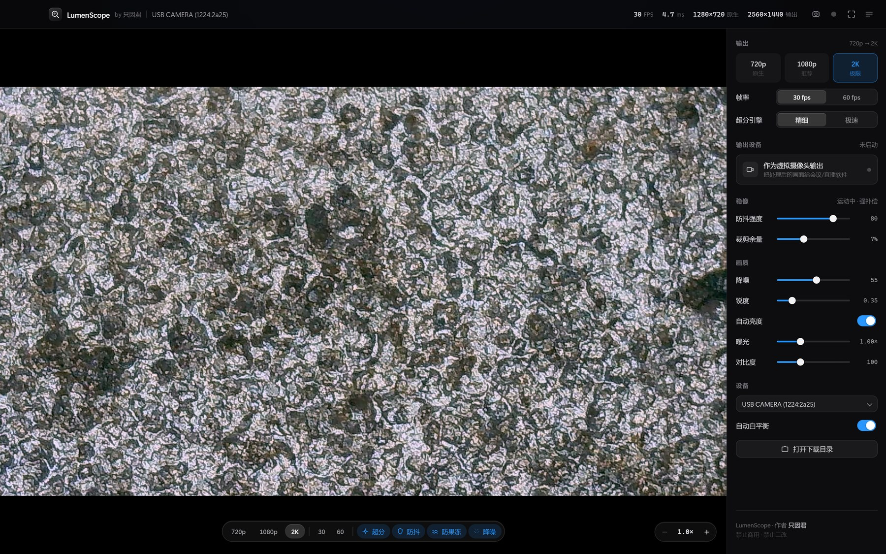
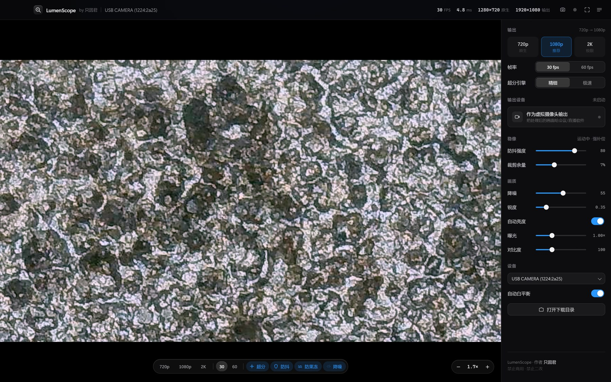
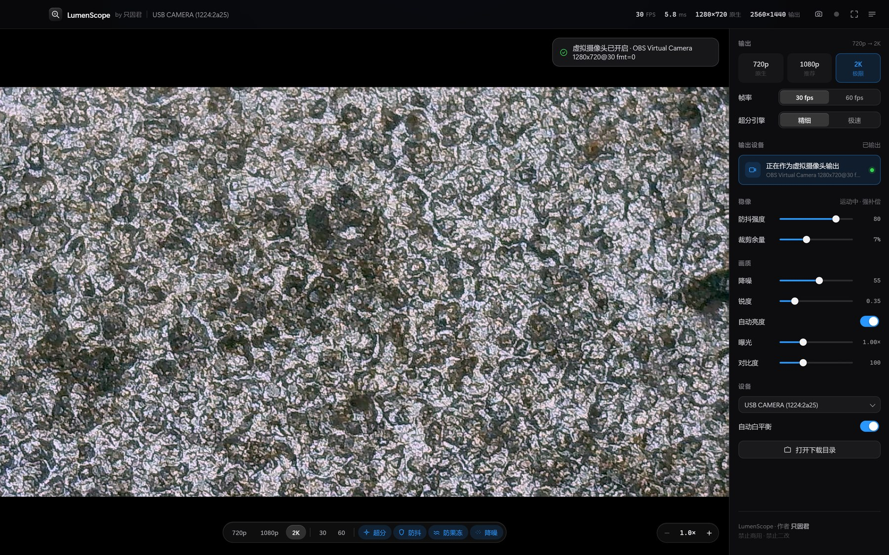

# LumenScope

**作者：只因君** · 禁止商用 · 禁止二改

一个能实时看 USB 摄像头 / USB 显微镜的小软件。插上就能看，顺手把画面修一修：超分、防抖、
去果冻、降噪、数字变焦，还能把处理完的画面当成一路虚拟摄像头，喂给会议和录屏软件。

杂牌摄像头也认，不用装驱动，能出画面就行。



**作者：只因君** · **禁止商用** · **禁止二改**
软件界面里也写明了：顶栏 `LumenScope by 只因君`，右侧面板底部固定一行「作者 只因君 / 禁止商用 · 禁止二改」。

---

## 先说清楚能干什么

| 场景 | 具体怎么用 |
| --- | --- |
| **看显微镜** | 生物切片、矿石、昆虫、纤维……暗场标本噪点多，降噪 + 超分后细节清楚很多 |
| **修手机** | 数码显微镜怼焊点、排线、主板走线，2K 加数字变焦看细小裂纹；手抖有防抖兜着 |
| **修电路板 / 焊东西** | 看丝印、虚焊、连锡；晃的时候不再"果冻"扭曲；开虚拟摄像头还能边修边录 |
| **随便一个杂牌 USB 摄像头** | 720p 的老摄像头也能超到 1080p，顺便把噪点压下去 |
| **在线教学 / 直播 / 远程看片** | 点一下「作为虚拟摄像头输出」，OBS、腾讯会议、钉钉里直接选它 |

---

## 怎么打开

三种方式，随便挑一个：

1. **双击桌面的 LumenScope 图标**（最省事）
2. 命令行 `node launch.js`
3. `node server.js`，然后浏览器开 `http://127.0.0.1:4173`

第一次打开如果没自动认出设备，点右侧「设备」下拉，选你那台摄像头就行。

如果提示设备被占用，多半是微信、钉钉、OBS 或者另一个 LumenScope 窗口正开着同一个摄像头，
关掉它们再点「重试」。

---

## 画面是怎么处理的

全在显卡上跑，1080p 输出大约 5–8 ms 一帧，2K 也就再多 2 ms 左右。

**超分辨率**：默认用 Lanczos-3，6×6 的 sinc 重建加抗振铃钳制，边缘干净不发虚。
另一档是 AMD 的 FSR（EASU + RCAS），快一点，画质略软，赶性能的时候用。

**防抖**：先切网格找画面里纹理多的块（用 Michelson 对比度筛，纯色区域不参与），
做由粗到细的块匹配，拟合出「平移 + 旋转 + 缩放」，再用滑动平均把"手抖"从"慢慢移动镜头"里分离出来，
只反向补偿抖动那部分。

**防果冻**：CMOS 是一行一行读出来的，晃动时上一行和下一行记录的其实是不同时刻，
直线就歪了、画面像果冻一样荡。这里按"整帧读出时间"反推每一行该在的位置，
拿 16 个控制行做逐行补偿，把整帧对齐到同一时刻。

**降噪**：SVGF 那一套。历史帧先按相机位移对齐再拿来用，然后估计局部方差、把历史钳在合理范围内，
按噪声水平自适应决定"信历史多少、信当前帧多少"。这样静止时噪点掉得很快，动了也不会拖影。

实测数据都在下面，脚本可以自己跑。

---

## 实拍效果

下面都是真画面，不是示意图。设备是插在电脑上的 `USB CAMERA`，原生 720p30。

**启动界面**（左侧设备列表、右侧全部控件，底部有作者署名）：



**1080p 输出**（720p 超分上来，降噪 + 防抖默认全开）：


**2K 输出**（右上角能看到 `1280×720 原生 → 2560×1440 输出`）：



**数字变焦 1.7×**（滚轮放大，右下角显示倍率）：



**作为虚拟摄像头输出**（右侧状态灯变绿，提示 `OBS Virtual Camera 1280x720@30`）：



---

## 数字变焦

鼠标滚轮缩放，以指针位置为中心，最大 8×。
放大以后按住左键拖动可以平移，双击画面回 100%。
右下角有个小胶囊显示当前倍率，点倍率数字直接复位。

缩放只改取样范围，不放大像素，所以放大后看到的是摄像头真实分辨率下的细节，不是糊掉的插值。

---

## 当虚拟摄像头用

点右侧面板「作为虚拟摄像头输出」，LumenScope 就把**处理完的画面**注册成系统里的一路摄像头。
OBS、腾讯会议、钉钉、微信视频号里都能选到它，别人看到的是超分+降噪+防抖之后的画面。

背后用的是本机 OBS 自带的虚拟摄像头驱动（装一次 OBS 就注册好了，平时不用开着 OBS），
加上 Python 3.11 的 pyvirtualcam，1080p30 实测不丢帧。

---

## 拍照和录像

按 `Ctrl+S` 拍照，`Ctrl+R` 开始/停止录像。文件直接进系统「下载」文件夹，
拍完就能在下载列表里看到，不用再去找。

录下来的是**处理之后**的画面，不是原始流——超分、降噪、防抖的结果都在里面。

想换保存位置，设个环境变量就行：`LUMEN_MEDIA_DIR`。

---

## 快捷键

| 按键 | 作用 |
| --- | --- |
| `Ctrl/⌘ + S` | 拍照 |
| `Ctrl/⌘ + R` | 开始 / 停止录像 |
| `1` `2` `3` | 720p / 1080p / 2K |
| `+` `-` | 放大 / 缩小 |
| `0` | 变焦复位 |
| `F11` | 全屏 |
| `Esc` | 退出全屏 |

---

## 实测数据

不是"看着更清楚"，是能复跑的数字。

**超分**（720p 超到 1080p，对照真实 1080p 参考帧）：

| 引擎 | PSNR | SSIM | 清晰度 |
| --- | --- | --- | --- |
| Lanczos-3（默认） | 34.37 dB | 0.9057 | 173.5 |
| FSR EASU+RCAS（极速） | 31.38 dB | 0.8559 | 138.3 |

Lanczos 多 3 dB、锐度高 25%，代价是每帧多约 2 ms。

**防果冻**（合成片源注入 6 px 逐行倾斜 + 6 px/帧横移）：

| | 行位移-高度斜率 |
| --- | --- |
| 关闭 | 5.98 px |
| 开启 | 1.70 px（**降低 71.6%**） |

**降噪**（σ=9/255 噪声，静态场景，对照无噪参考帧）：

| 降噪强度 | 时域噪声 | PSNR |
| --- | --- | --- |
| 0（关） | 7.72 | 29.1 dB |
| 0.35 | 2.59 | 37.4 dB |
| **0.55（默认）** | 1.77 | **39.9 dB** |
| 0.9 | 0.97 | 34.6 dB |

0.9 以上虽然肉眼更"干净"，但 PSNR 反而掉了——那是把细节当噪声一起抹了。

想自己验证：

```bash
node server.js &                  # 先起服务
node scripts/check-live.js        # 回归：分辨率切换、功能开关、控制台异常、帧率
node scripts/test-zoom.js         # 数字变焦：滚轮/拖拽/按钮/键盘/复位
node scripts/bench-quality.js     # 防果冻 + 降噪
node scripts/bench-upscale.js     # 超分保真度
```

脚本自带 headless Chrome + CDP，不用装 Puppeteer。

---

## 目录结构

```
LumenScope/
├─ launch.js                 一键启动（有 Electron 用 Electron，没有就用 Chrome --app）
├─ 启动 LumenScope.vbs        桌面快捷方式调用的启动脚本（不带黑框）
├─ server.js                 本地静态服务 + /api/vcam、/api/save、/api/reveal
├─ src/
│  ├─ index.html · app.js    界面与交互
│  ├─ styles/app.css         暗场设计系统
│  └─ core/
│     ├─ gl.js               WebGL2 封装（pass / FBO / 纹理）
│     ├─ pipeline.js         管线：上传→防抖→防果冻→降噪→超分→测光→呈现
│     ├─ motion.js           运动估计 + 平滑
│     ├─ vcam.js             虚拟摄像头推流客户端
│     └─ shader/             fsr / lanczos / temporal / meter
├─ native/
│  ├─ vcam_bridge.js         WebSocket 桥 + 子进程管理
│  ├─ ws_server.js           极简 WebSocket 服务端
│  └─ vcam_host.py           pyvirtualcam 宿主
├─ electron/                 无边框桌面壳
├─ scripts/                  验证与基准脚本
└─ docs/                     图标、截图、基准结果
```

---

## 常见问题

**画面是黑的 / 找不到设备**
摄像头被别的程序占着。微信、OBS、相机 App 都会抢独占，关掉再在「设备」里重选一次。

**虚拟摄像头列表里没有 OBS Virtual Camera**
装一次 OBS Studio 就有这个驱动，不用打开 OBS，也不用它常驻。

**2K 卡**
2560×1440 对显卡有要求。切成 30 fps，或者退回 1080p。

**画面太亮 / 太暗**
关掉「自动亮度」，用曝光滑杆手动调。显微镜那边建议先把光调到能看清轮廓再进软件。

**想换个摄像头**
「设备」下拉里随便选，分辨率会自动商量（优先 1080p，其次 720p，最后 640×480）。

---

## 授权

**禁止商用，禁止二改。** 详细条款见 [LICENSE](LICENSE)。

个人自用没问题——学习、看标本、修自己的手机和电路板都算。
要商用得先找作者「只因君」拿授权。

软件里重写了几个公开算法（FSR、vid.stab 的思路、SVGF、One-Euro filter），
出处和原始许可记在 [NOTICE-algorithms.md](NOTICE-algorithms.md)。
