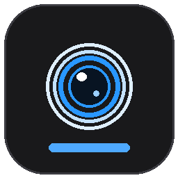

<div align="center">



# LumenScope

**把普通 USB 摄像头，用成一个像样的显微观察台。**

超分辨率 · 电子防抖 · 卷帘校正 · 时域降噪 · 数字变焦 · 虚拟摄像头输出

[](https://github.com/456erddgr/lumenscope/releases/latest)
[](#安装)
[](https://www.khronos.org/webgl/)
[](LICENSE)
[](https://github.com/456erddgr)

[下载安装包](https://github.com/456erddgr/lumenscope/releases/latest) · [功能](#功能) · [截图](#截图) · [常见问题](#常见问题)

</div>

---

## 这个软件解决什么问题

便宜的 USB 摄像头和数码显微镜都有三个通病：**画面小、噪点多、手一碰就晃**。
原厂软件通常只给你一个预览窗口，最多调个亮度对比度，画质本身没法救。

LumenScope 就是补这一块的。它把摄像头原始画面接进来，实时跑一遍图像处理，
再以 1080p 或 2K 输出：

- 720p 的老摄像头 → **超分到 1080p / 2K**，锯齿和糊边明显减少
- 暗场标本的彩色噪点 → **时域降噪**压下去，同时保住纹理不被抹平
- 手持或桌面震动 → **电子防抖**反向补偿，画面稳住
- 快速移动时的"果冻"扭曲 → **卷帘快门校正**按行对齐
- 想凑近看细节 → **数字变焦 1×–8×**，不损失分辨率

处理完的画面还能**注册成一路虚拟摄像头**，OBS、腾讯会议、钉钉里直接选，
配合录屏讲解非常方便。

<div align="center">

</div>

## 功能

### 画质

| | 说明 |
| --- | --- |
| **超分辨率** | Lanczos-3（6×6 抽头 sinc 重建 + 抗振铃钳制）为默认；另提供 AMD FSR（EASU + RCAS）作为"极速"档 |
| **时域降噪** | SVGF 方案：历史帧按相机位移重投影对齐，方差引导自适应混合，静态处快速收敛、运动处不拖影 |
| **电子防抖** | 网格选场 → 由粗到细块匹配 → 拟合平移/旋转/缩放 → 滑动平均分离"抖动"与"运镜" |
| **卷帘快门校正** | 按整帧读出时间模型反推每行曝光时刻的位置，16 控制行逐行补偿，消除果冻与倾斜 |
| **自动曝光 / 白平衡** | 中心加权测光 + 高光软饱和约束；gray-world 白平衡带增益限幅，保留染色标本本来颜色 |
| **锐度 / 对比度 / 饱和度** | 面板实时可调，所见即所得 |

### 操作

- **数字变焦**：滚轮以指针为中心缩放，拖动平移，双击回 100%，倍率最高 8×
- **分辨率档位**：720p / 1080p / 2K，一键切换
- **帧率**：30 fps / 60 fps
- **一键开关**：超分、防抖、防果冻、降噪各自独立，可以 A/B 对比
- **快捷键**：`Ctrl+S` 拍照 · `Ctrl+R` 录像 · `1/2/3` 分档 · `+/-` 变焦 · `0` 复位 · `F11` 全屏

### 输出

- **虚拟摄像头**：处理后的画面作为一路摄像头输出给其他软件
  - **跟随当前输出档位**：界面选 1080p 就输出 1920×1080，选 2K 就输出 2560×1440，30/60 fps 同步
  - 切档位时会自动重启驱动（OBS 虚拟摄像头的格式在打开时固定，必须重开才能生效）
  - 输出的是**算法处理之后**的画面：超分、降噪、防抖、防果冻的结果都在里面
- **拍照 / 录像**：直接落到系统「下载」文件夹，**录的是处理后的画面**
- **无边框窗口**：自绘标题栏，暗色界面，不抢注意力

## 截图

**2K 输出**（顶栏可见 `1280×720 原生 → 2560×1440 输出`）

<div align="center"></div>

**数字变焦 1.7×**

<div align="center"></div>

**作为虚拟摄像头输出**（右侧状态灯亮起，提示 `OBS Virtual Camera`）

<div align="center"></div>

> 以上截图均来自真实设备 `USB CAMERA`（原生 720p30），非示意图。

## 安装

### 一键安装（推荐）

到 [Releases](https://github.com/456erddgr/lumenscope/releases/latest) 下载 `LumenScope-Setup-x.x.x.exe`，双击即可。

安装程序会自己做完这些事，不需要你干预：

1. 装主程序（默认装到当前用户目录，不弹目录选择）
2. 创建桌面快捷方式和开始菜单项
3. 装完自动启动，并在后台准备虚拟摄像头所需的运行时
4. 如果系统里没有合适的 Python，会下载一个便携版到用户目录（不改系统环境）

装完桌面上就有 `LumenScope` 图标，双击打开，在「设备」里选你的摄像头即可。

### 从源码运行

```bash
git clone https://github.com/456erddgr/lumenscope.git
cd lumenscope
npm install
npm start            # Electron 窗口
# 或
node server.js       # 然后浏览器打开 http://127.0.0.1:4173
```

需要 Node 18+。

**虚拟摄像头**（界面切档 → 系统另一进程实读）

| 界面档位 | 驱动实际输出 | 帧率 |
| --- | --- | ---: |
| 1080p | 1920×1080 | 30 fps |
| 2K | 2560×1440 | 30 fps |

输出内容确认是处理后的画面（同一帧对比）：

| 处理状态 | 清晰度 | 颗粒噪声 |
| --- | ---: | ---: |
| 全部关闭（等于原始流） | 780 | 7.40 |
| 只开超分 | **1164（+49%）** | 7.93 |
| 超分 + 降噪 + 防抖 + 锐化 | 842 | **6.77（更低）** |

## 实测数据

不是"看起来更清楚"，下列数字都由仓库里的脚本生成，可以复跑。

**超分**（720p → 1080p，对照真实 1080p 参考帧）

| 引擎 | PSNR | SSIM | 边缘清晰度 |
| --- | ---: | ---: | ---: |
| **Lanczos-3（默认）** | **34.37 dB** | **0.9057** | **173.5** |
| FSR EASU + RCAS | 31.38 dB | 0.8559 | 138.3 |

**防果冻**（合成片源注入 6 px 逐行倾斜 + 6 px/帧横移）

| | 行位移-高度斜率 |
| --- | ---: |
| 关闭 | 5.98 px |
| 开启 | **1.70 px（降低 71.6%）** |

**降噪**（σ = 9/255 合成噪声，静态场景）

| 降噪强度 | 时域噪声 | PSNR |
| --- | ---: | ---: |
| 0（关闭） | 7.72 | 29.1 dB |
| 0.35 | 2.59 | 37.4 dB |
| **0.55（默认）** | **1.77** | **39.9 dB** |
| 0.90 | 0.97 | 34.6 dB |

> 0.9 以上肉眼更"干净"，但 PSNR 反而下降 —— 那是把细节一起当成噪声平均掉了。
> 默认取 0.55 是这条曲线的最好位置。

复跑方式：

```bash
node server.js &
node scripts/bench-upscale.js     # 超分
node scripts/bench-quality.js     # 防果冻 + 降噪
node scripts/check-live.js        # 功能回归
node scripts/test-zoom.js         # 数字变焦交互
node scripts/verify-vcam-res.js   # 虚拟摄像头是否按档位输出（1080p/2K）
node scripts/verify-vcam-processed.js  # 输出的是不是处理后的画面
```

脚本自带 headless Chrome + CDP 驱动，不需要额外装 Puppeteer。

## 适用场景

- **显微镜观察**：生物切片、矿石、昆虫、纤维、焊接检查
- **手机维修**：焊点、排线、主板走线、芯片丝印
- **电路维修**：虚焊、连锡、元件偏移
- **老摄像头翻新**：720p 升到 1080p，噪点压制
- **在线教学 / 直播**：虚拟摄像头接会议和 OBS

## 技术实现

前端是原生 JavaScript + WebGL2，没有框架、没有构建步骤；桌面壳用 Electron。

画面走一条 GPU 管线：

```
摄像头 → 上传纹理
   → 防抖采样（相似变换）
   → 卷帘校正（逐行时间对齐）
   → 时域降噪（SVGF + 重投影）
   → 超分（Lanczos-3 / FSR EASU+RCAS）
   → 测光（自动曝光 / 白平衡）
   → 呈现
```

1080p 输出单帧 4–8 ms，2K 约 10 ms，都在 30 fps 预算之内。

## 常见问题

**摄像头打不开，提示被占用**
微信、钉钉、OBS、相机 App 会独占摄像头。关掉它们再点「重试」。

**列表里没有 OBS Virtual Camera**
装一次 [OBS Studio](https://obsproject.com/) 就会注册这个驱动。不需要开着 OBS，也不需要它常驻。

**2K 卡顿**
2560×1440 对显卡有要求。切 30 fps，或退回 1080p。明亮环境下建议开 1080p + 60 fps。

**画面太亮或太暗**
关掉「自动亮度」用曝光滑杆手动控制。显微镜先把光调到能看清轮廓，再进软件微调。

**虚拟摄像头功能不可用**
安装程序会在首次启动时自动补齐依赖；如果当时网络不通，可以手动执行一次：

```powershell
powershell -ExecutionPolicy Bypass -File "$env:LOCALAPPDATA\LumenScope\setup-runtime.ps1"
```

## 授权

**禁止商用，** 也 **禁止二次修改后分发**。条款见 [LICENSE](LICENSE)。

个人自用（学习、观察、修自己的设备）完全没问题。商业用途需要向作者取得授权。

软件中独立重写了若干公开算法（FSR、vid.stab 思路、SVGF、One-Euro filter），
出处与原始许可见 [NOTICE-algorithms.md](NOTICE-algorithms.md)。

---

<div align="center">

**作者：只因君** · 禁止商用 · 禁止二改

</div>
